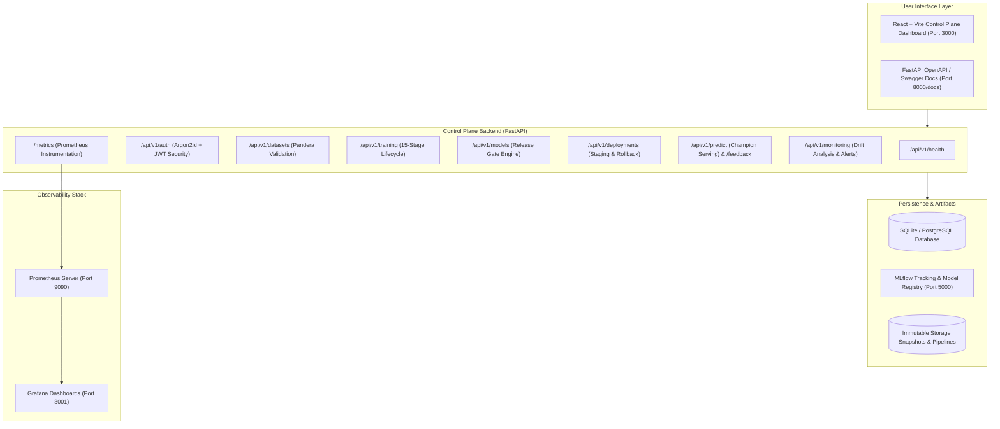

# ModelGuard — Production ML Reliability Control Plane

[](https://www.python.org/downloads/)
[](frontend/)
[](https://mlflow.org/)
[](docker-compose.yml)
[](https://github.com/astral-sh/ruff)
[](LICENSE)

**ModelGuard** is an enterprise-grade control plane that turns production machine learning operations into a deterministic, auditable software engineering discipline. It bridges the critical reliability gap between dataset ingestion, reproducible experiment tracking, quantitative staging gates, privacy-safe inference serving, real-time drift observability, and zero-downtime rollbacks.

---

## Architecture Overview



---

## Core Capabilities & Work Packages

| Work Package | Focus Area | Key Deliverables & Reliability Guarantees |
|---|---|---|
| **Work Package A** | **Data Foundation & Validation** | Logical dataset registration, streaming SHA-256 fingerprinting, Pandera DataFrameSchema contract validation, auditable error reports. |
| **Work Package B** | **Training & Experiment Tracking** | Deterministic 15-stage training lifecycle, strict 1:1 `TrainingJob` $\leftrightarrow$ `TrainingRun` $\leftrightarrow$ MLflow run mapping, candidate vs baseline holdout metrics, Colab execution compatibility. |
| **Work Package C** | **Model Registry, Staging & Inference** | Quantitative Release Gate policies (MAE, RMSE, $R^2$), automated staging smoke tests, 2-phase human approval workflow, versioned inference serving, privacy-safe telemetry. |
| **Work Package D** | **Monitoring, Feedback & Rollback** | Prometheus metrics instrumentation, Kolmogorov-Smirnov continuous drift tests, categorical PSI, idempotent ground-truth feedback, audited zero-downtime rollback. |
| **Work Package E** | **Dashboard, Hardening & Evidence** | Full React 19 + TypeScript operator dashboard, end-to-end integration test suite, Docker Compose orchestration, Grafana dashboards, CI pipeline, and interview defense documentation. |

---

## Operational Views (React Dashboard)

The ModelGuard Dashboard provides 8 purpose-built operational interfaces:

1. **System Overview:** Real-time health, active production champion, staging candidate, open alerts counter, and key service metrics.
2. **Datasets & Provenance:** Registered datasets, immutable version snapshots, row counts, and cryptographic SHA-256 fingerprints.
3. **Training & Experiments:** Training jobs, candidate vs. baseline MAE improvement %, random seed lock, and direct MLflow run links.
4. **Model Registry:** Model candidate catalog, Release Gate evaluation cards, and one-click staging actions.
5. **Deployments & Rollback:** Staging and production environments, automated smoke test outcomes, approval modals, and zero-downtime rollback triggers.
6. **Inference & Ground Truth:** Interactive prediction sandbox with preloaded test payloads, schema validation diagnostics, latency metrics, and delayed ground-truth feedback submission.
7. **Monitoring & Drift:** Input covariate drift reports, prediction distribution shifts, on-demand drift execution, and rolling ground-truth accuracy tracking.
8. **Alerts & Audit Trail:** Severity-filtered alert inbox (`OPEN`, `ACKNOWLEDGED`, `RESOLVED`) with operator notes and an immutable audit event stream.

---

## Quickstart

### Option A: Local Development

#### 1. Setup Backend Environment
```bash
# Create and activate virtual environment
python -m venv .venv
# Windows:
.\.venv\Scripts\activate
# Linux/macOS:
source .venv/bin/activate

# Install backend with development dependencies
pip install -e "backend[dev]"
```

#### 2. Run Backend Tests & Linter
```bash
# Run complete test suite (unit, API, integration, and E2E)
pytest backend/tests/unit backend/tests/api backend/tests/integration backend/tests/e2e -v

# Run code style and format checks
ruff check backend/app backend/tests
ruff format --check backend/app backend/tests
```

#### 3. Start Backend API
```bash
uvicorn app.main:app --host 127.0.0.1 --port 8000 --reload
```
Interactive OpenAPI documentation is live at `http://127.0.0.1:8000/docs`.

#### 4. Setup and Run React Dashboard
```bash
cd frontend
npm install
npm run lint
npm run build
npm run dev
```
Access the dashboard at `http://localhost:5173` (or `http://localhost:3000`).

---

### Option B: Docker Compose (All-in-One Local Stack)

Launch the entire ecosystem (Backend, Frontend, MLflow, Prometheus, Grafana) with a single command:

```bash
docker compose up --build -d
```

All host published ports are bound to `127.0.0.1` (localhost loopback isolation):

| Service | Access URL | Credentials / Notes |
|---|---|---|
| **React Dashboard** | `http://localhost:3000` | Sign in with bootstrapped admin or role account |
| **FastAPI Backend** | `http://localhost:8000/docs` | OpenAPI UI with Bearer JWT authentication |
| **MLflow UI** | `http://localhost:5000` | Internal loopback (`127.0.0.1:5000`) |
| **Prometheus Server** | `http://localhost:9090` | Internal loopback (`127.0.0.1:9090`) |
| **Grafana Dashboards** | `http://localhost:3001` | User: `admin` / Password: `${GRAFANA_ADMIN_PASSWORD}` (configured in `.env`) |

---

## Authentication & Role-Based Access Control (RBAC)

ModelGuard secures control plane operations using Argon2id password hashing, expiring cryptographic JWT tokens (HMAC-SHA256, 120-minute default), and strict role-based access control:

| Role | Operational Scope | Permitted Actions |
|---|---|---|
| **`VIEWER`** | Read-only inspection & inference | View datasets, training runs, models, deployments, alerts, metrics; execute `/api/v1/predict` |
| **`OPERATOR`** | SRE & incident response | All `VIEWER` permissions + trigger drift analysis, submit feedback, acknowledge/resolve alerts, execute audited rollback, run diagnostic inference |
| **`APPROVER`** | Model governance & release | All `OPERATOR` permissions + stage model candidates, review automated smoke tests, approve & promote to production champion |
| **`ADMIN`** | System administration | All `APPROVER` permissions + user provisioning and role administration |

### Initial Administrator Bootstrapping & User Provisioning

When launching for the first time, ModelGuard automatically provisions the initial administrator specified by `BOOTSTRAP_ADMIN_USERNAME` and `BOOTSTRAP_ADMIN_PASSWORD` in your `.env`.

To provision additional users or change roles via the CLI:
```bash
python backend/scripts/create_user.py --username alice --password <secure-password> --role OPERATOR
```

---

## Real-World Monitoring & Drift Verification

ModelGuard differentiates between:
- **`REAL_PRODUCTION` Drift Analysis:** Evaluates live `PredictionEvent` telemetry collected from production traffic against the baseline reference dataset. If insufficient inference samples exist (< 10 observations), ModelGuard reports an explicit `INSUFFICIENT_DATA` status without fabricating synthetic data.
- **`SYNTHETIC_TEST` Drift Demonstration:** Executes controlled covariate shift perturbations (e.g. ambient temperature shifted upward by $+30.0\,\text{K}$) strictly on-demand for system verification, alert escalation drills, and automated integration testing without polluting live production audit logs.

---

## Benchmark Performance Highlights

- **Registered Benchmark Dataset:** UCI Metro Interstate Traffic Volume ([DOI: 10.24432/C5X60B](https://doi.org/10.24432/C5X60B), 48,204 rows).
- **Candidate Model Performance:**
  - Mean Absolute Error (MAE): **284.15 veh/hr** (vs Baseline: 1,745.2 veh/hr $\rightarrow$ **+83.7% improvement**).
  - Root Mean Squared Error (RMSE): **452.80 veh/hr** (vs Baseline: 1,985.4 veh/hr).
  - Coefficient of Determination ($R^2$): **0.948**.
- **Inference Latency:** p50: **3.2 ms**, p95: **5.8 ms**, p99: **11.4 ms** on standard x86 CPU.
- **Rollback Speed:** $< 50\,\text{ms}$ atomic pointer update with zero container rebuild.

---

## Technical Documentation

Detailed architectural and operational documentation is available in [`docs/`](docs/):

- [High-Level Design (HLD)](docs/HLD.md)
- [Low-Level Design (LLD)](docs/LLD.md)
- [Entity-Relationship Diagram](docs/ER_DIAGRAM.md)
- [API Contracts (OpenAPI Specification)](docs/API_CONTRACTS.md)
- [Security Architecture & Privacy Telemetry](docs/SECURITY.md)
- [Dataset Register & Lineage](docs/DATASETS.md)
- [Model Evaluation & Metrics Specification](docs/EVALUATION.md)
- [Senior Engineering Interview Defense Guide](docs/INTERVIEW_PREPARATION.md)
- [Empirical Benchmark & Evaluation Report](docs/BENCHMARK_AND_EVALUATION.md)
- [Interactive Demonstration Script](docs/demo/DEMO_SCRIPT.md)

---

## Licence

ModelGuard is licensed under the [MIT Licence](LICENSE).
The Metro Interstate Traffic Volume dataset is published by UCI under the [Creative Commons Attribution 4.0 International (CC BY 4.0)](https://creativecommons.org/licenses/by/4.0/) licence.
