# ModelGuard — Entity-Relationship (ER) Diagram

This document specifies the complete relational data architecture of the ModelGuard ML Reliability Control Plane. All entities are mapped using SQLAlchemy and backed by SQLite (or PostgreSQL in production deployments).

```mermaid
erDiagram
    DATASETS ||--o{ DATASET_VERSIONS : "has immutable snapshots"
    DATASETS ||--o{ DATA_CONTRACTS : "defines contracts for"
    DATASET_VERSIONS ||--o{ VALIDATION_RUNS : "evaluated by"
    DATASET_VERSIONS ||--o{ TRAINING_JOBS : "trained on"
    DATASET_VERSIONS ||--o{ TRAINING_RUNS : "referenced in"
    DATASET_VERSIONS ||--o{ MODEL_CANDIDATES : "provenance for"
    DATA_CONTRACTS ||--o{ VALIDATION_RUNS : "enforced in"
    VALIDATION_RUNS ||--o{ TRAINING_JOBS : "prerequisite for"
    TRAINING_JOBS ||--|| TRAINING_RUNS : "1:1 execution"
    TRAINING_RUNS ||--o{ MODEL_CANDIDATES : "produces"
    MODEL_CANDIDATES ||--o{ DEPLOYMENTS : "staged and promoted"
    MODEL_CANDIDATES ||--o{ PREDICTION_EVENTS : "serves inference"
    DEPLOYMENT_ENVIRONMENTS ||--o{ DEPLOYMENTS : "hosts"
    DEPLOYMENT_ENVIRONMENTS ||--o| MODEL_CANDIDATES : "active champion pointer"
    PREDICTION_EVENTS ||--o| PREDICTION_FEEDBACKS : "1:1 ground truth"
    MONITORING_REPORTS ||--o{ MONITORING_ALERTS : "triggers"

    DATASETS {
        string id PK
        string name UK
        string task_type
        string source_uri
        string licence
        text description
        datetime created_at
    }

    DATASET_VERSIONS {
        string id PK
        string dataset_id FK
        string version_tag
        string storage_uri
        string sha256_hash
        bigint byte_size
        integer row_count
        json columns_json
        string schema_hash
        datetime created_at
    }

    DATA_CONTRACTS {
        string id PK
        string dataset_id FK
        string version_tag
        json contract_schema_json
        boolean is_active
        datetime created_at
    }

    VALIDATION_RUNS {
        string id PK
        string dataset_version_id FK
        string contract_id FK
        string status
        integer error_count
        integer warning_count
        json details_json
        datetime created_at
    }

    AUDIT_EVENTS {
        string id PK
        string actor
        string action
        string resource_type
        string resource_id
        json before_state_json
        json after_state_json
        text reason
        datetime created_at
    }

    TRAINING_JOBS {
        string id PK
        string dataset_version_id FK
        string validation_run_id FK
        json config_json
        string status
        string queue_job_id
        datetime created_at
        datetime updated_at
    }

    TRAINING_RUNS {
        string id PK
        string training_job_id FK,UK
        string mlflow_run_id
        string dataset_version_id FK
        string git_sha
        string dependency_lock_hash
        string python_version
        integer random_seed
        string split_manifest_uri
        json metrics_json
        string artifact_uri
        string status
        datetime started_at
        datetime completed_at
        datetime created_at
    }

    MODEL_CANDIDATES {
        string id PK
        string training_run_id FK
        string dataset_version_id FK
        string mlflow_model_name
        string mlflow_model_version
        string model_uri
        string artifact_uri
        json signature_json
        json input_contract_json
        json metrics_json
        json gate_evaluation_json
        string status
        datetime created_at
        datetime updated_at
    }

    DEPLOYMENT_ENVIRONMENTS {
        string id PK
        string name UK
        string active_candidate_id FK
        datetime updated_at
    }

    DEPLOYMENTS {
        string id PK
        string environment_id FK
        string candidate_id FK
        string previous_candidate_id FK
        string status
        json smoke_test_results_json
        string approved_by
        datetime approved_at
        text approval_rationale
        datetime created_at
        datetime completed_at
    }

    PREDICTION_EVENTS {
        string id PK
        string inference_id UK
        string candidate_id FK
        string model_name
        string model_version
        datetime request_time
        float latency_ms
        string status
        json prediction_json
        json input_summary_json
    }

    PREDICTION_FEEDBACKS {
        string id PK
        string inference_id FK,UK
        float actual_value
        datetime submitted_at
        string submitted_by
        text notes
    }

    MODEL_QUALITY_REPORTS {
        string id PK
        string model_name
        string model_version
        datetime window_start
        datetime window_end
        integer sample_count
        integer labeled_sample_count
        float label_coverage
        float mae
        float rmse
        float r2
        string status
        json details_json
        datetime created_at
    }

    MONITORING_REPORTS {
        string id PK
        string report_type
        string model_name
        string model_version
        datetime reference_window_start
        datetime reference_window_end
        datetime current_window_start
        datetime current_window_end
        integer reference_sample_count
        integer current_sample_count
        string detection_method
        string policy_version
        boolean is_drift_detected
        json summary_json
        json metrics_json
        text limitations
        datetime created_at
    }

    MONITORING_ALERTS {
        string id PK
        string report_id FK
        string model_name
        string model_version
        string alert_type
        string severity
        text message
        json triggering_evidence_json
        string status
        string acknowledged_by
        datetime acknowledged_at
        string resolved_by
        datetime resolved_at
        text resolution_notes
        datetime created_at
    }
```

## Relational Constraints & Invariants

1. **Immutable Dataset Versions:** `dataset_versions` records can never be updated once written. The SHA-256 fingerprint enforces binary integrity at storage locations.
2. **Deterministic Training Execution:** `training_jobs` and `training_runs` enforce a strict 1:1 relationship via `training_runs.training_job_id (unique=True)`. Every retry yields a new job and run record.
3. **Release Gate Boundary:** A candidate in `model_candidates` cannot transition to `STAGED` unless `gate_evaluation_json` contains `passed: true`.
4. **Two-Phase Human-in-the-Loop Promotion:** Models staged in `staging` require an automated smoke test pass followed by explicit human sign-off (`approved_by`, `approval_rationale`) prior to atomic production activation.
5. **Audited Rollback Guarantee:** Rollback creates a new `Deployment` record pointing back to `previous_candidate_id`, swapping the MLflow alias `champion` and updating `deployment_environments.active_candidate_id` atomically.
6. **Privacy-Safe Telemetry:** Raw inference input values are never stored in `prediction_events`. Only statistical metadata (record count, feature presence, latency) is persisted in `input_summary_json`.
