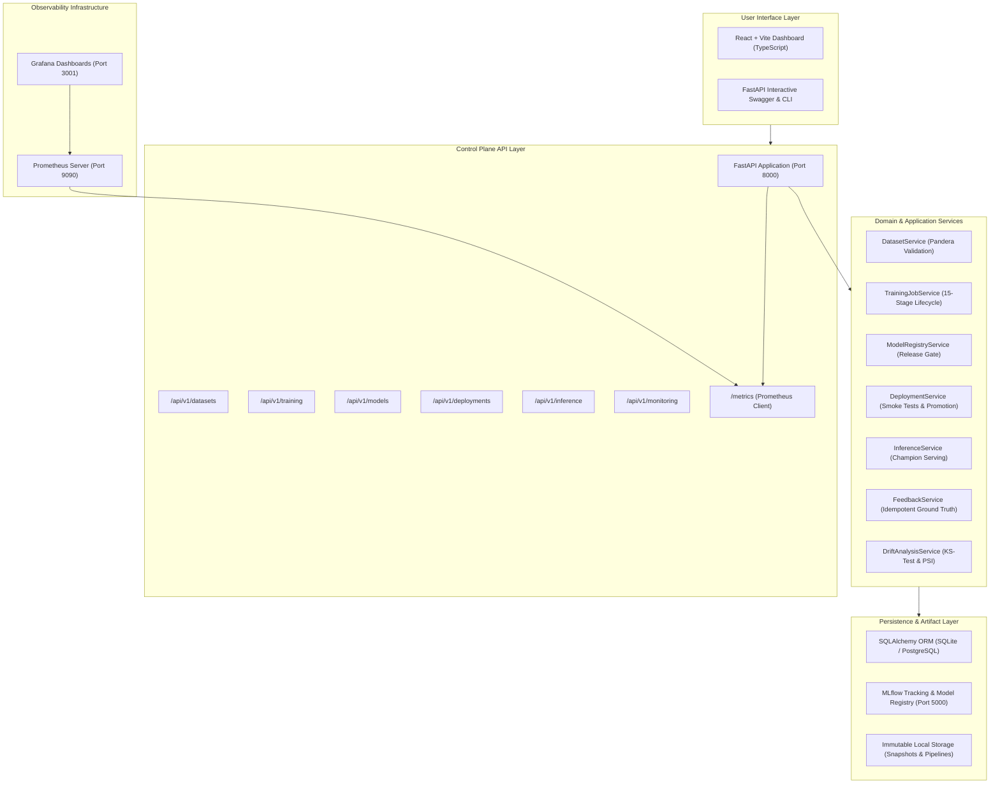

# ModelGuard — High-Level Design (HLD)

## 1. System Overview

ModelGuard is an enterprise-grade control plane for production machine learning reliability. It bridges the critical reliability gap between model development, experiment tracking, staging validation, production serving, and real-time operational observability.

Unlike ad-hoc MLOps scripts, ModelGuard provides **architectural guarantees**:
- **Dataset Immutability & Provenance:** Cryptographically fingerprinted dataset versions with contract validation.
- **Deterministic Training Orchestration:** Strict 1:1 job-to-run mappings with full MLflow experiment tracking.
- **Quality Gates:** Quantitative release gate thresholds enforcing candidate superiority over baselines.
- **Two-Phase Staging & Deployment:** Automated staging smoke tests followed by human sign-off prior to production promotion.
- **Zero-Downtime Audited Rollback:** Single-command rollback restoring proven champion aliases and audit logs.
- **Continuous Monitoring:** Kolmogorov-Smirnov drift detection, Population Stability Index (PSI), and delayed ground-truth accuracy tracking.

---

## 2. Architecture Diagram

---

## 3. Technology Stack & Key Choices

| Subsystem | Technology | Rationale |
|---|---|---|
| **API Backend** | FastAPI 0.111 + Uvicorn | High performance, automatic OpenAPI documentation, asynchronous event handling, type safety. |
| **Data Validation** | Pandera 0.20 + Pandas 2.2 | Declarative DataFrame contract schema validation with rich error diagnostics. |
| **ML Modeling** | Scikit-Learn 1.6 | Fast, reproducible regression pipelines (RandomForestRegressor + Mean Baseline). |
| **Experiment Tracking** | MLflow 2.20 | Standardized run tracking, artifact persistence, and model registry aliases (`champion`). |
| **Relational Storage** | SQLAlchemy 2.0 + SQLite/Postgres | Strongly typed ORM models with cascading foreign keys and audit history. |
| **Frontend UI** | React 19 + TypeScript + Vite | Clean, responsive control-plane interface without bloated dependencies. |
| **Telemetry & Metrics** | Prometheus Client + Grafana | Standard Prometheus scrape format with pre-configured dashboard visual panels. |

---

## 4. Key Architectural Patterns

1. **Service Layer Pattern:** Clean separation of concerns between HTTP routes (`app/api/v1`), domain business logic (`app/services`), data access (`app/db`), and ML training/inference primitives (`app/ml`).
2. **Deterministic State Transitions:** Model candidates and deployments follow explicit finite state machines. Illegal transitions (e.g., staging an unvalidated model or promoting an unapproved deployment) are blocked with `InvalidOperationError`.
3. **Idempotency & Auditing:** Ground-truth feedback submission is strictly idempotent on identical values and throws `FeedbackConflictError` on contradictory values. Every state modification records an immutable `AuditEvent`.
