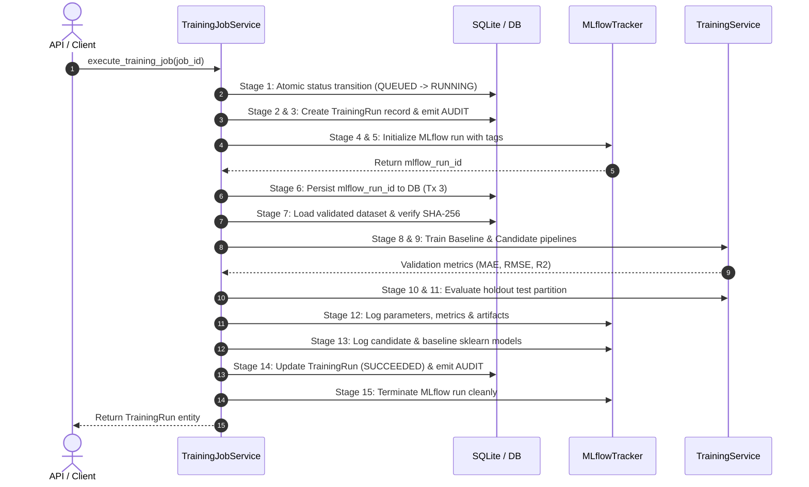

# ModelGuard — Low-Level Design (LLD)

## 1. Subsystem Architecture & Service Design

ModelGuard decouples concerns into dedicated domain services located under `backend/app/services/`:

```
backend/app/
├── services/
│   ├── dataset_service.py       # Ingestion, SHA-256 fingerprinting, Pandera validation
│   ├── training_job_service.py  # 15-stage training lifecycle orchestration
│   ├── model_registry_service.py# Candidate registration & Release Gate policy evaluation
│   ├── deployment_service.py    # Staging smoke tests, human approval, promotion & rollback
│   ├── inference_service.py     # Versioned inference serving & privacy telemetry
│   ├── feedback_service.py      # Idempotent ground-truth feedback recording
│   ├── drift_service.py         # Kolmogorov-Smirnov & PSI statistical drift analysis
│   └── monitoring_service.py    # Alert resolution, Prometheus metric updates & health
```

---

## 2. 15-Stage Deterministic Training Lifecycle

The execution of a training job follows a strictly ordered, transactionally isolated 15-stage lifecycle implemented in `TrainingJobService.execute_training_job()`:



### Lifecycle Guarantees:
- **Atomic Guards:** Duplicate calls to execute a non-queued job fail immediately with `InvalidOperationError`.
- **Immediate ID Persistence:** The `mlflow_run_id` is persisted to disk before resource-intensive fitting commences.
- **Root Exception Preservation:** If an internal exception occurs, the MLflow run is marked `FAILED` with failure stage tags while preserving the root cause.

---

## 3. Release Gate Evaluation Algorithm

Model candidates must satisfy strict quantitative criteria before staging is permitted:

$$\text{Passed} \iff (\text{MAE}_{\text{cand}} \le \text{Threshold}_{\text{MAE}}) \land (\text{RMSE}_{\text{cand}} \le \text{Threshold}_{\text{RMSE}}) \land (R^2_{\text{cand}} \ge \text{Threshold}_{R^2}) \land (\text{Imp}_{\text{MAE}} \ge \text{Threshold}_{\text{Imp}})$$

Where relative improvement is calculated as:
$$\text{Imp}_{\text{MAE}} = \frac{\text{MAE}_{\text{baseline}} - \text{MAE}_{\text{cand}}}{\text{MAE}_{\text{baseline}}} \times 100\%$$

If any threshold is violated, the candidate status becomes `GATE_FAILED` and all rejection reasons are persisted in `gate_evaluation_json`.

---

## 4. Staging Smoke Testing & 2-Phase Promotion

1. **Automated Smoke Checks:** When `stage_candidate(candidate_id)` is invoked, ModelGuard:
   - Verifies the candidate has status `GATE_PASSED`.
   - Loads the exact serialized pipeline directly from `candidate.model_uri`.
   - Passes a representative synthetic sample payload through the model.
   - Verifies the output contains finite numerical predictions and records latency.
   - Sets deployment status to `AWAITING_APPROVAL` (or `SMOKE_FAILED` on failure).
2. **Explicit Human-in-the-Loop Approval:**
   - Operator reviews smoke test metrics and calls `approve_deployment(deployment_id, actor, rationale)`.
   - Deployment transitions from `AWAITING_APPROVAL` to `APPROVED`.
3. **Atomic Production Promotion:**
   - `promote_deployment(deployment_id, actor)` sets production environment `active_candidate_id = candidate.id`.
   - MLflow alias `champion` is atomically assigned to the candidate version.
   - Previous champion is archived and recorded in `previous_candidate_id`.

---

## 5. Zero-Downtime Audited Rollback Mechanics

When operational degradation is detected in production:
1. Operator invokes `rollback_deployment(deployment_id, actor, reason)`.
2. ModelGuard identifies `previous_candidate_id` from the active deployment.
3. A new `Deployment` record is created targeting `production` with the restored candidate.
4. The MLflow model registry alias `champion` is atomically swapped back to the previous version.
5. `deployment_environments.active_candidate_id` is updated.
6. An immutable `AuditEvent` is written recording the operator, rationale, and state change.
7. Subsequent calls to `/api/v1/inference/predict` instantly serve the restored candidate version with zero container rebuild or service downtime.

---

## 6. Statistical Drift Detection Engine

The `DriftAnalysisService` evaluates distribution divergence between a baseline reference dataset and production inference windows:
- **Continuous Features:** Two-sample Kolmogorov-Smirnov (KS) test.
  $$D = \sup_x |F_{\text{ref}}(x) - F_{\text{curr}}(x)|$$
  Drift is flagged when $p \le \alpha$ (default $\alpha = 0.05$).
- **Categorical Features:** Population Stability Index (PSI).
  $$\text{PSI} = \sum_{i} (P_i - Q_i) \times \ln\left(\frac{P_i}{Q_i}\right)$$
  Flagged when $\text{PSI} \ge 0.20$ (significant distribution shift).
- **Persistent Alerts:** When drift is detected in any feature, a `MonitoringAlert` of severity `WARNING` is created and linked to the drift report.
