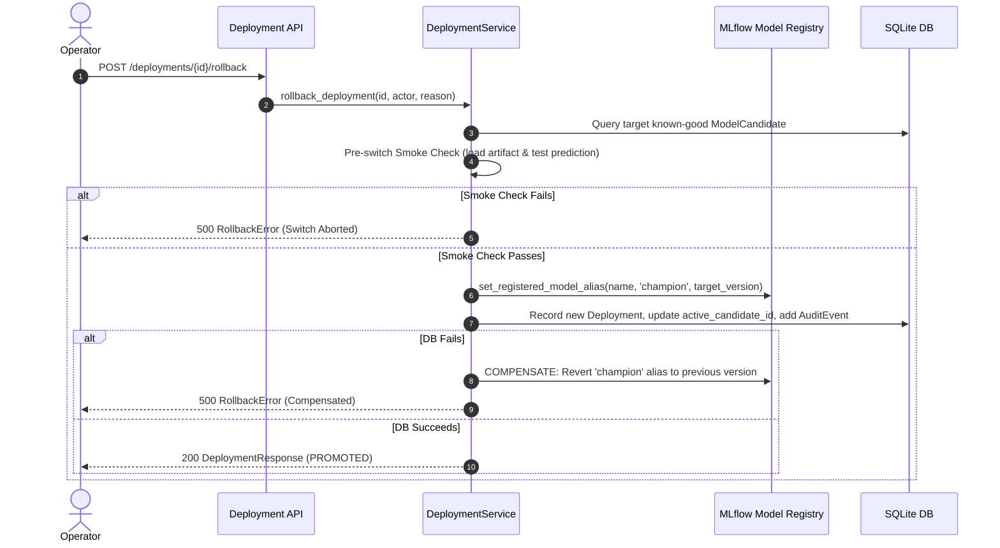

# ModelGuard — Work Package D: Monitoring, Feedback & Rollback Guide

## 1. Overview & Architectural Boundaries

Work Package D implements the continuous observability and automated safeguard loop for ModelGuard:
1. **Prometheus Service & Model Telemetry**: Low-overhead runtime monitoring exposing `/metrics` without exposing sensitive payloads.
2. **Input Covariate Drift**: Multi-method statistical divergence detection (Kolmogorov-Smirnov test, Population Stability Index, and Total Variation Distance) comparing current inference batches with registered reference snapshots.
3. **Prediction Drift**: Statistical distribution analysis of model outputs strictly decoupled from input feature drift and ground-truth verification.
4. **Delayed Feedback Ingestion & Rolling Quality**: Idempotent ground-truth submission (`POST /api/v1/feedback`) with conflict rejection, computing rolling MAE, RMSE, and $R^2$ with explicit handling for insufficient labels.
5. **Actionable Alerts**: Persistent, auditable monitoring alerts linking directly to statistical evidence and model provenance.
6. **Deterministic Fault Scenarios**: Fully reproducible test harnesses for covariate shifts, missing value spikes, invalid categories, output drift, concept degradation, and infrastructure failures.
7. **Audited Rollback**: Safe production rollback (`POST /api/v1/deployments/{id}/rollback`) restoring known-good historical champions with pre-switch artifact verification, atomic MLflow alias updates, and compensation logic.

---

## 2. Prometheus Instrumentation & Service Monitoring

### 2.1 Exposition Endpoints
Prometheus scrapers consume metrics from:
- `GET /metrics` (Root application level)
- `GET /api/v1/metrics` (API Router level)

### 2.2 Metric Catalog

| Metric Name | Type | Labels | Description |
|---|---|---|---|
| `modelguard_http_requests_total` | Counter | `method`, `endpoint`, `status_code` | HTTP throughput by method, normalized endpoint, and status. |
| `modelguard_errors_total` | Counter | `error_type`, `endpoint` | Operational and domain exceptions. |
| `modelguard_inference_latency_seconds` | Histogram | `model_name`, `model_version` | Serving latency in seconds across standard distribution buckets. |
| `modelguard_active_model_version` | Gauge | `model_name`, `environment`, `model_version` | Set to 1.0 for the active production or staging model version. |
| `modelguard_model_load_failures_total` | Counter | `model_name`, `environment` | Total failed attempts to load model artifacts. |
| `modelguard_component_health` | Gauge | `component` | Health status (1=healthy, 0=unhealthy) for database, storage, etc. |
| `modelguard_drift_detected` | Gauge | `model_name`, `model_version`, `drift_type` | Binary indicator (1=drift, 0=stable) for `data_drift` and `prediction_drift`. |
| `modelguard_model_quality_metric` | Gauge | `model_name`, `model_version`, `metric` | Rolling evaluated quality scores (`mae`, `rmse`, `r2`) against delayed feedback. |

### 2.3 Cardinality & Privacy Safeguards
- URL paths are normalized (e.g. `/api/v1/models/{id}` replaces raw UUIDs) to eliminate high cardinality in time-series series keys.
- Raw inference inputs and customer identifiers are strictly excluded from metric labels and telemetry summaries.

---

## 3. Drift Analysis Methodology

### 3.1 Input Feature Drift
The input drift engine compares incoming inference data against the reference baseline (the immutable `DatasetVersion` snapshot or training reference distribution):
- **Continuous Features** (`temp`, `rain_1h`, `snow_1h`, `clouds_all`):
  - **Two-Sample Kolmogorov-Smirnov Test**: Tests whether current and reference samples are drawn from the same continuous distribution ($\alpha = 0.05$).
  - **Population Stability Index (PSI)**: Quantile-based population divergence:
    $$\text{PSI} = \sum_{i=1}^{k} (Q_i - P_i) \ln\left(\frac{Q_i}{P_i}\right)$$
    A threshold of $\text{PSI} > 0.25$ flags significant distribution shift.
- **Categorical Features** (`holiday`, `weather_main`, `weather_description`):
  - **Total Variation Distance (TVD)**: Compares category probability distributions:
    $$\text{TVD} = \frac{1}{2} \sum_{c \in C} |P(c) - Q(c)|$$
    A threshold of $\text{TVD} > 0.20$ flags significant frequency shift.
- **Data Quality & Missing Values**:
  - Shifts in missing value rates exceeding $10\%$ ($\Delta > 0.10$) trigger data quality alerts.

> [!IMPORTANT]
> **Governance Constraint**: A detected input feature drift indicates covariate shift; it does **not** constitute mathematical proof of model degradation. True accuracy degradation can only be verified once delayed ground-truth feedback arrives.

### 3.2 Prediction Drift
Prediction drift is evaluated independently from input feature drift:
- Compares output predicted distributions between current inference windows and reference baseline holdouts.
- Evaluates output mean, standard deviation, and KS test statistic.
- Output shifts may indicate seasonal demand variation or macroeconomic shifts and are never conflated with verified accuracy degradation.

---

## 4. Delayed Feedback & Rolling Model Quality

### 4.1 Ingestion Contract (`POST /api/v1/feedback`)
Ground truth labels arrive asynchronously through:
```json
{
  "inference_id": "c1f7a224-b659-4d80-8712-42c235ba9738",
  "actual_value": 3450.0,
  "submitted_by": "traffic_sensor_feed",
  "notes": "Verified roadside induction loop reading"
}
```

### 4.2 Idempotency and Conflict Rejection
1. **Valid Inference Check**: Verifies that `inference_id` exists in `prediction_events`. If not found, returns HTTP 404.
2. **Idempotent Resubmission**: If feedback for `inference_id` already exists with matching `actual_value` (within float tolerance $10^{-5}$), the existing record is returned with HTTP 200 without modifying state.
3. **Conflict Rejection**: If feedback exists with a conflicting `actual_value`, the request is rejected with HTTP 409 (`FeedbackConflictError`).
4. **Historical Immutability**: Historical predictions in `prediction_events` are never modified or overwritten.

### 4.3 Quality Evaluation Semantics (`GET /api/v1/quality`)
- **Insufficient Labels**: When labeled samples are below `min_samples` (default: 10), the system explicitly returns status `INSUFFICIENT_LABELS` and sets `mae=None, rmse=None, r2=None` to prevent statistical noise from false alarms.
- **Sufficient Labels**: Once $\ge 10$ labeled pairs are available, rolling MAE, RMSE, and $R^2$ are computed.
  - If MAE exceeds threshold ($450.0$), a `QUALITY_DEGRADATION` alert is raised with severity `WARNING` or `CRITICAL`.

---

## 5. Alerts & Lifecycle Management

Alerts are persisted in the `monitoring_alerts` table and link directly to triggering evidence and report IDs.

| Severity | Triggers | Required Operator Action |
|---|---|---|
| `INFO` | Minor category frequency change, single-feature mild PSI | Review on dashboard. |
| `WARNING` | Moderate prediction drift, single numeric feature KS drift ($p < 0.05$) | Inspect input data quality and recent inferences. |
| `CRITICAL` | Severe multi-feature drift ($\ge 3$ features), rolling MAE $> 450.0$, model load failure | Investigate upstream pipelines, prepare rollback if quality degraded. |

Operators manage alerts via:
- `POST /api/v1/alerts/{id}/acknowledge`: Mark alert `ACKNOWLEDGED`.
- `POST /api/v1/alerts/{id}/resolve`: Mark alert `RESOLVED` with mandatory remediation notes.

---

## 6. Deterministic Fault Scenarios

The suite includes 6 fully deterministic, reproducible fault scenarios located in `app.scenarios.fault_scenarios`:

1. **Feature Distribution Shift** (Seed 42): Adds a $+25.0\text{K}$ temperature shock to `temp`. Detected via KS test ($p < 0.001$) and PSI ($> 0.25$), triggering a `DATA_DRIFT` alert.
2. **Missing-Value Spike** (Seed 42): Nullifies $40\%$ of `clouds_all` values. Detected via missing rate delta $> 0.10$, triggering a `DATA_DRIFT` alert.
3. **Invalid Categorical Values** (Seed 42): Injects unobserved category `'AlienVortex'` into `weather_main`. Detected via Total Variation Distance shift.
4. **Prediction Distribution Shift** (Seed 42): Shifts prediction distribution mean from $\sim 3000$ to $\sim 6500$. Detected via prediction KS test ($p < 0.001$), triggering a `PREDICTION_DRIFT` alert.
5. **Concept Degradation With Delayed Labels** (Seed 42): Generates 12 predictions where actual roadside traffic deviates by $> 750$ vehicles. Evaluates rolling MAE $> 450.0$, triggering a `QUALITY_DEGRADATION` alert.
6. **Serving Failure Simulation** (Seed 42): Queries a corrupted artifact URI, verifying controlled `InferenceError` handling, metric increment of `modelguard_model_load_failures_total`, and HTTP 500 without crashing the service.

---

## 7. Audited Rollback Procedure

When model degradation or operational failure occurs, operators initiate an immediate rollback:
`POST /api/v1/deployments/{deployment_id}/rollback`

### 7.1 Rollback Execution Sequence


### 7.2 Safety Invariants
1. **Target Artifact Integrity**: Target model is loaded and tested with sample inferences *before* modifying any production pointers.
2. **Atomic Alias & Compensation**: The MLflow alias `champion` is updated. If the database transaction fails to commit, a compensating revert restores the prior MLflow alias.
3. **Audit History Immutability**: Historical deployments and prediction events are never deleted or truncated.
4. **Immediate Serving Parity**: Future calls to `POST /api/v1/predict` immediately resolve and execute the restored champion version.
