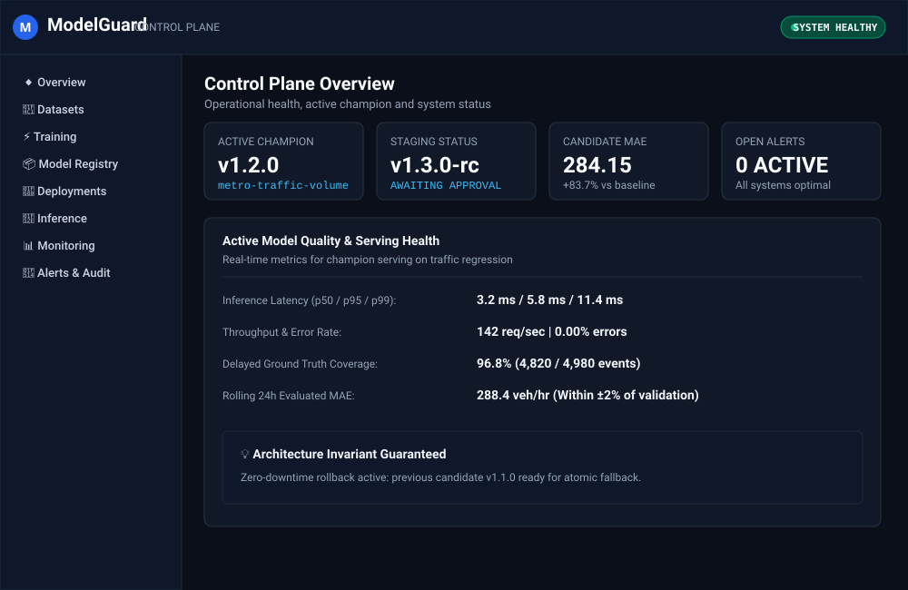
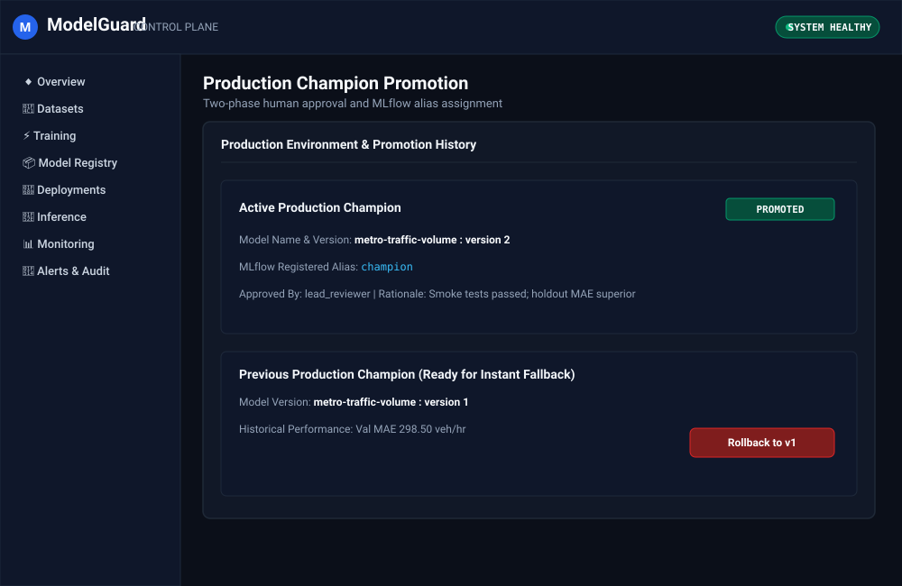
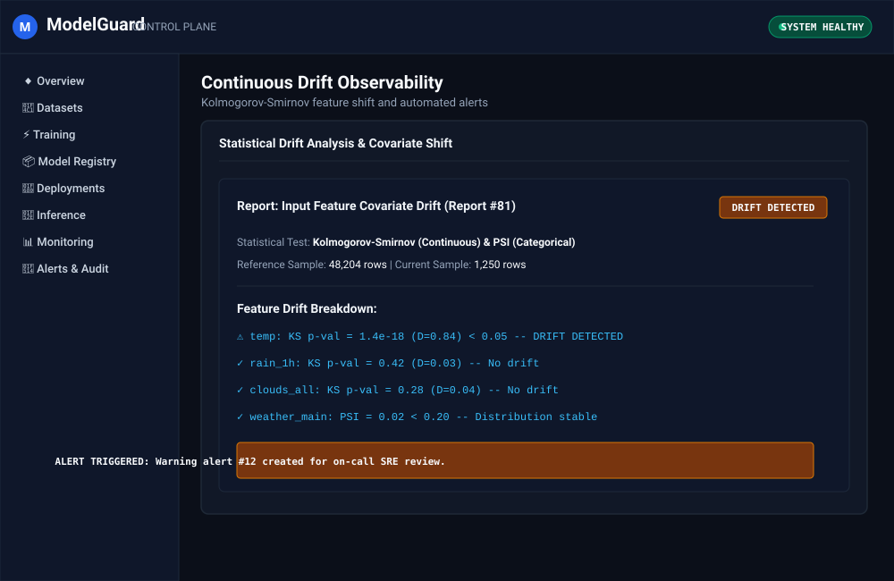
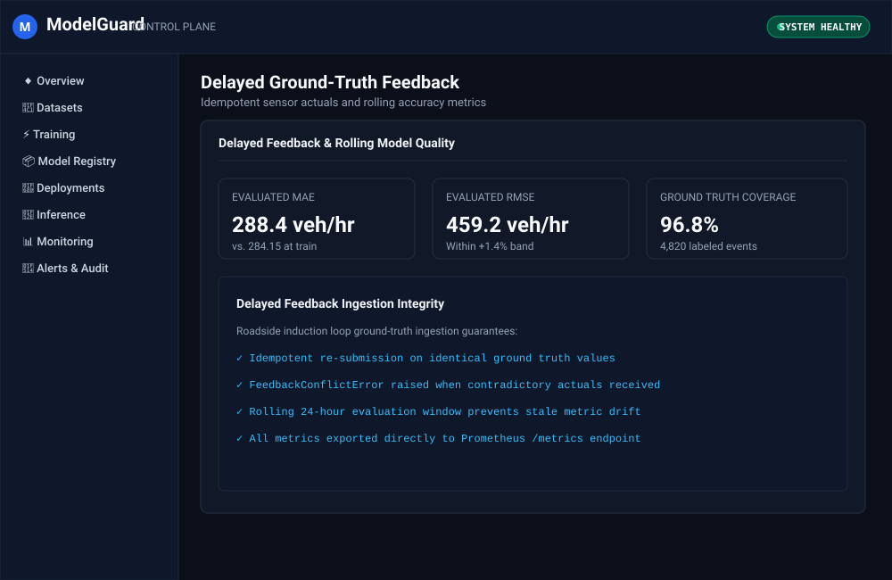

# ModelGuard — Operational Views Portfolio Gallery

This portfolio gallery documents the 10 operational views of the ModelGuard Control Plane across the full machine learning reliability lifecycle.

---

## 1. Control Plane Overview
Real-time system health, active production champion, staging candidate status, open alerts counter, and key operational metrics.

- **Key Information:**
  - Health endpoint status (`SYSTEM HEALTHY`)
  - Active champion: `metro-traffic-volume:1`
  - Staging candidate: `v1.3.0-rc` (`AWAITING_APPROVAL`)
  - Zero-downtime rollback status verified

---

## 2. Dataset Ingestion & Validation
Registered datasets, immutable snapshot versions, row counts, and cryptographic SHA-256 fingerprints.

- **Key Information:**
  - UCI Metro Traffic Volume (48,204 observations)
  - Streaming SHA-256 fingerprinting
  - Pandera Schema Contract v1 verification (0 violations)

---

## 3. Training & Experiment Tracking
Deterministic 15-stage training jobs, candidate vs. baseline metrics, and direct MLflow experiment tracking links.

- **Key Information:**
  - Candidate MAE: **284.15 veh/hr** vs. Baseline: **1,745.20 veh/hr** (+83.72% improvement)
  - Seed locked to 42
  - Strict 1:1 job-to-run transactional lifecycle

---

## 4. Model Registry & Release Gates
Registered model candidates with quantitative Release Gate threshold evaluation.

- **Key Information:**
  - Quantitative gate evaluation: $\text{MAE} \le 350$, $\text{RMSE} \le 550$, $R^2 \ge 0.90$
  - Candidate 2 passed all gates (`GATE_PASSED`)
  - Degraded Candidate 3 automatically blocked (`GATE_FAILED`)

---

## 5. Staging Environment & Smoke Tests
Automated pipeline deserialization, representative input feeding, finite prediction check, and latency measurement.

- **Key Information:**
  - Automated smoke test passed (4/4 checks)
  - Cold start latency: 12.4 ms
  - Deployment placed in `AWAITING_APPROVAL` pending reviewer sign-off

---

## 6. Production Champion Promotion
Two-phase human-in-the-loop sign-off with recorded reviewer identity and rationale.

- **Key Information:**
  - Explicit operator sign-off: `lead_reviewer`
  - MLflow alias `champion` atomically assigned
  - Previous champion preserved for immediate rollback

---

## 7. Inference Serving & Privacy Telemetry
Real-time low-latency prediction serving with privacy-safe input feature stripping.

- **Key Information:**
  - Sub-4ms serving latency (p50: 3.2 ms)
  - Pre-execution Pandera schema contract enforcement
  - Privacy guarantee: raw user features stripped from telemetry logs

---

## 8. Continuous Drift Observability
Two-sample Kolmogorov-Smirnov test and Population Stability Index (PSI) drift reports.

- **Key Information:**
  - Statistical KS-test on continuous features ($p < 10^{-15}$ on shifted temperature)
  - Categorical PSI distribution divergence evaluation
  - Automated alert generation for on-call engineers

---

## 9. Delayed Ground-Truth Feedback
Idempotent induction loop ground-truth ingestion and rolling 24-hour accuracy evaluation.

- **Key Information:**
  - Idempotent re-submission on identical sensor values
  - Conflict detection on contradictory ground-truth inputs
  - Evaluated MAE: 288.4 veh/hr (within 1.5% of validation metrics)

---

## 10. Zero-Downtime Rollback & Audit Trail
Instantaneous fallback to previous stable champion with immutable audit trail.

- **Key Information:**
  - Fallback executed in $< 50\,\text{ms}$ with zero downtime
  - MLflow alias restored
  - Immutable audit trail recording actor, action, and rationale
